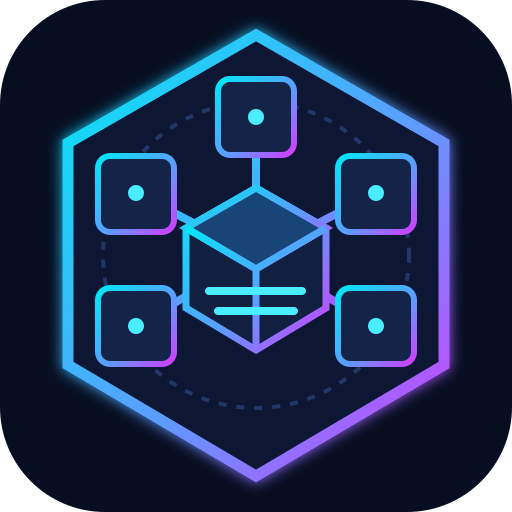
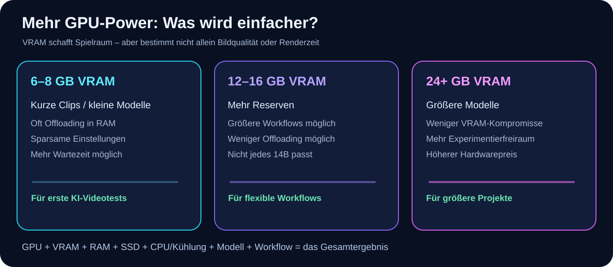
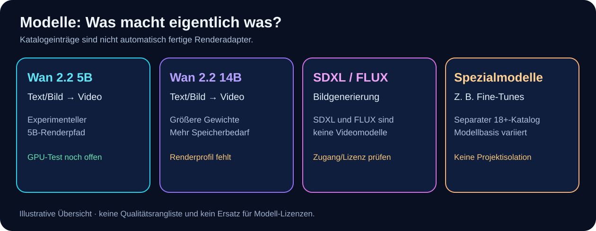
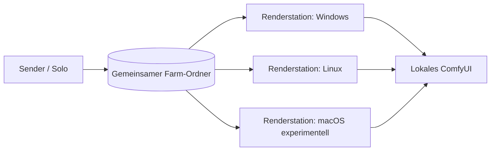

\n\n# RenderFarm Studio

**Eine RenderFarm. Viele Rechner. Ein verständliches Studio.**

**Windows · Linux · macOS · ComfyUI**

[**Projektwebsite**](https://derstyle.github.io/RenderFarm-Studio/) · [**Installation**](docs/INSTALLATION.md) · [**Entwicklungsstand**](docs/STATUS.md) · [**Mitentwickeln**](CONTRIBUTING.md)

## Worum geht es?

**RenderFarm Studio** ist ein experimentelles Community-Projekt zur KI-Bild- und Videoproduktion auf mehreren *eigenen oder vertrauenswürdigen Rechnern*.

Die gleiche Anwendung bietet drei umschaltbare Rollen:

| Rolle | Aufgabe |
| --- | --- |
| **Sender** | Projekte, Shots und Aufträge erstellen; Stationen und Warteschlange verwalten |
| **Renderstation** | GPU und Modelle prüfen, Jobs abarbeiten und direkt lokal rendern |
| **Solo / Lokal** | Sender und Worker auf demselben Rechner kombinieren |

Ein gemeinsamer, vom Betriebssystem bereitgestellter Farm-Ordner (z. B. NAS) verbindet die Computer. Die eigentliche KI-Berechnung läuft lokal über **[ComfyUI](https://www.comfy.org/download)**.

> [!WARNING]
> **Experimental Alpha 0.4 – kein fertiges Produktionsrelease.** Oberfläche, Queue, Worker und API wurden softwareseitig getestet; die ComfyUI-Video-Rückgabe wurde bisher mit einem Testserver geprüft. **Ein echter Wan-2.2-GPU-Videorender wurde noch nicht nachgewiesen.** Nicht für ungeschützte Internetzugriffe oder unvertraute Worker-Netze geeignet.

## Funktionsstand

| Bestandteil | Stand |
| --- | --- |
| Gemeinsame Oberfläche mit Sender / Renderstation / Solo | ✅ implementiert |
| Hardwareerkennung (GPU, RAM, lokaler Speicher) | ✅ treiber- und OS-abhängig |
| Gemeinsamer Farm-Ordner, Queue und Heartbeat | 🧪 Softwaretests |
| ComfyUI erkennen und bei Bedarf lokal starten | 🧪 installationsabhängig |
| Modellkatalog: Wan 2.2 / SDXL / FLUX | ✅ Grundfunktion |
| Kennzeichnung von 18+- und zugangsbeschränkten Modellangeboten | ✅ Katalog-Labels |
| Wan 2.2 5B Videoworkflow | 🧪 echter GPU-Test offen |
| Wan 2.2 14B direkt rendern | 🚧 noch nicht freigegeben |
| Universelle native Ein-Klick-Installer | 🚧 noch nicht abgeschlossen |
| Remote-Updates nur mit Freigabe der Renderstation | 📋 geplant |
| Projektspezifische Lernprofile und LoRA-Training | 📋 geplant |

[**Ausführliche Statusübersicht**](docs/STATUS.md) · [**Roadmap**](docs/ROADMAP.md)

## Warum GPU-Leistung nicht gleich Bildqualität ist\n\n

| Grafikspeicher | Typische Möglichkeiten | Häufige Einschränkungen |
| --- | --- | --- |
| **6–8 GB** | Speicheroptimierte Workflows und kurze Clips | mehr Offloading, kleinere Modelle oder niedrigere Auflösung |
| **12–16 GB** | mehr Freiraum, größere Arbeitslasten | sehr große Modelle passen nicht zwingend komplett |
| **24 GB+** | große Modelle und aufwendigere Szenen | höherer Preis; gleiche Modellqualität nicht automatisch besser |

**Einordnung statt Benchmark:** Tatsächliche Renderzeit, Qualität und Modellunterstützung müssen reproduzierbar gemessen werden.

[GPU und VRAM erklärt](docs/HARDWARE.md) · [Modellfamilien](docs/MODELLE.md) · [Benchmarks mitmachen](docs/BENCHMARKS.md)\n\n

## Architektur

*Zielarchitektur; noch nicht auf allen Plattformen in realer Videoproduktion validiert.*

## Installation

Für die aktuelle Alpha: **Python 3.10+**, ein installiertes ComfyUI sowie passende GPU-Treiber und Modellgewichte. Native Windows-/macOS-Installer und ein vollständiger automatischer ComfyUI-Setup-Assistent sind noch offen.

**[Installationsanleitung lesen](docs/INSTALLATION.md)**. Öffentliche Installer werden nach gesonderter Prüfung über **GitHub Releases** angeboten. GitHub selbst ist keine Render-Queue und speichert keine KI-Modellgewichte.

## Gemeinsam besser machen

Neue GPU-Messungen, Linux-/macOS-Tests, Fehlerberichte, Doku-Übersetzungen, nachvollziehbare ComfyUI-Workflows und bessere Nutzerführung sind willkommen.

**[Beitragen](CONTRIBUTING.md)** · **[Sicherheit](SECURITY.md)** · **[Bekannte Grenzen](docs/STATUS.md)**

Bitte keine Kennwörter, fremden Nutzerdaten, privaten Filme/Prompts, persönlichen NAS-Pfade oder unrechtmäßig weitergegebenen Modellgewichte in Issues oder Commits veröffentlichen.

---

*Stand: 26. November 2026 · Public-Alpha-Projekt. Die originalen großen PNG-Grafiken und der vollständige Alpha-Quellcode werden nach einer separaten Veröffentlichungsprüfung ergänzt. Die gezeigten SVGs sind illustrative Projektgrafiken.*

## Entwicklung unterstützen ☕

RenderFarm Studio wird von **Dampfrad Labs** entwickelt. Wenn dir das Projekt gefällt, kannst du seine Weiterentwicklung freiwillig unterstützen: [Buy Me a Coffee – Dampfrad Labs](https://buymeacoffee.com/timmeyerdea). Alle Funktionen bleiben ohne Spende zugänglich. Die aktuelle experimentelle Alpha ist noch kein bestätigtes Produktionsrelease.
