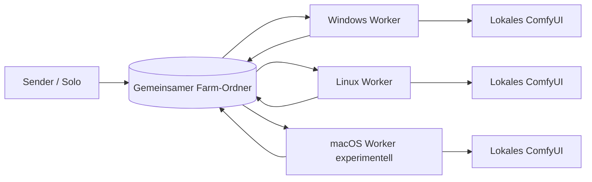

# Architektur · Unified Alpha 0.4

Die gemeinsame Anwendung verwendet einen **lokalen Python-Dienst**, eine Browseroberfläche und eine **dateibasierte Job-/Stationskommunikation**. GPU-Aufgaben gehen an ein lokales ComfyUI.

Der NAS- oder Sharing-Pfad muss zuvor durch das Betriebssystem eingebunden werden. Die Alpha speichert keine NAS-Anmeldung für einen beliebigen Remote-SMB-Server.

**Sicherheitsgrenze:** Gemeinsame Ordner sind derzeit keine kryptografisch authentifizierte Job-Warteschlange. Nur Rechner, denen alle Beteiligten vertrauen, dürfen dort schreiben.

Für einen stabilen Produktiveinsatz fehlen signierte Aufträge und Updates, sichere Abbrüche/Wiederaufnahme, belastbare Tests über heterogene Betriebssysteme und technisch strikt isolierte Projektdaten.
