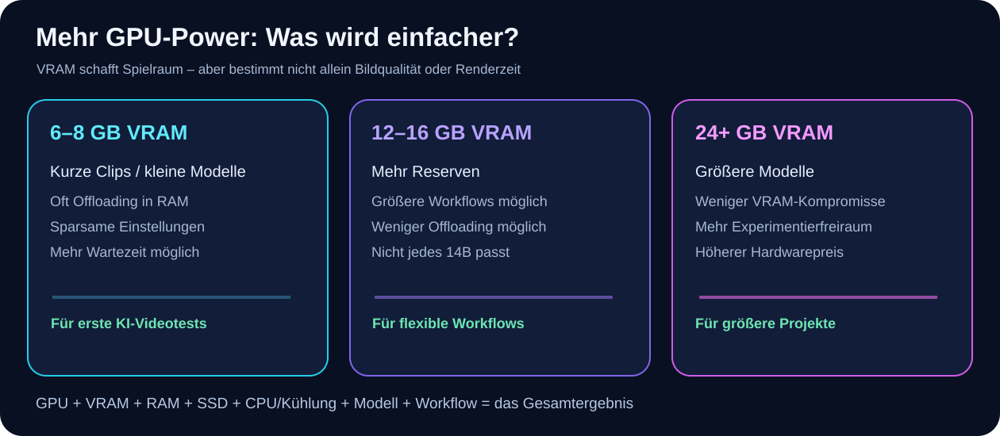

# Hardware für Einsteiger: GPU, VRAM, RAM, SSD und CPU

- **GPU:** führt die Berechnung aus.
- **VRAM:** der schnelle Arbeitsspeicher auf der Grafikkarte.
- **RAM:** kann ausgelagerte Modellteile und Zwischendaten vorhalten.
- **SSD:** speichert Modelle und Ergebnisse. Sie ersetzt keinen VRAM.
- **CPU und Kühlung:** beeinflussen Laden, Vorbereitung und stabilen Dauerbetrieb.

| VRAM | Mögliche Vorteile | Grenzen |
| --- | --- | --- |
| 6–8 GB | kürzere Tests und speichersparende Workflows | häufig Offloading, Quantisierung, kleinere Auflösung |
| 12–16 GB | mehr Spielraum für Modelle und Auflösung | große Videomodelle passen nicht zwingend in den VRAM |
| 24+ GB | mehr Modell- und Workflowoptionen | Qualität hängt weiterhin vom Modell ab |

**Gleiches Modell mit gleichen Einstellungen und Offloading:** meist langsamer, aber nicht automatisch ein schlechteres Bild. Bei anderem Modell, reduzierter Präzision oder kleinerer Auflösung **kann** sich die Qualität ändern.

Einminütige Filme lassen sich aus mehreren kurzen KI-Shots schneiden. Das ist nicht identisch mit einer Minute zusammenhängender KI-Generierung.

**Das sind keine Benchmarks.** GPU-Generation, Laptop-Leistungslimit, Speicherbandbreite, VRAM, ComfyUI-Version, Modelldatei und Sampler beeinflussen die Ergebnisse. Messprotokoll: [BENCHMARKS.md](BENCHMARKS.md).
