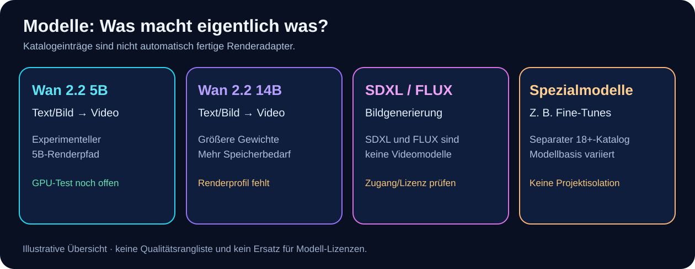

# Modellfamilien in RenderFarm Studio Alpha 0.4

| Modell | Typ | Stand in Alpha 0.4 | Einschränkung |
| --- | --- | --- | --- |
| Wan 2.2 TI2V 5B | Text/Bild → Video | Katalog + experimenteller Renderadapter | Offloading möglich; echter GPU-Test fehlt |
| Wan 2.2 I2V A14B FP8 | Bild → Video | Download-Katalog | **Kein** freigegebener Renderadapter |
| Wan 2.2 T2V A14B FP8 | Text → Video | Download-Katalog | **Kein** freigegebener Renderadapter |
| Wan 2.1 GGUF Legacy | Video | existierende Spezialworkflows | nicht generisch installierbar |
| SDXL | Bild | externe Modellquelle | kein Video-Adapter |
| FLUX.1-dev | Bild | externe Modellquelle 🔒 | Zugangs-/Lizenzbedingungen prüfen |
| 18+-Modelle / spezialisiertes Fine-Tuning | unterschiedlich | **gesonderte Katalogkategorie** | keine fertige technische Projektisolation |
| Leonardo und andere Cloudangebote | Cloud-Videodienst | Vergleichsoption 🔒 | kein lokaler GPU-Checkpoint |

**Wichtig:** Das 🔒-Symbol zeigt erforderlichen Zugang, Genehmigungen oder kostenpflichtige Angebote. Es bedeutet **nicht immer**, dass ein Modell Geld kostet. Downloadbarkeit bedeutet ebenfalls **nicht automatisch kommerzielle Nutzungsrechte**.

Offizielle Referenzen: [ComfyUI Wan 2.2](https://docs.comfy.org/tutorials/video/wan/wan2_2), [Wan Modelle](https://huggingface.co/Comfy-Org/Wan_2.2_ComfyUI_Repackaged), [SDXL](https://huggingface.co/stabilityai/stable-diffusion-xl-base-1.0), [FLUX.1-dev](https://huggingface.co/black-forest-labs/FLUX.1-dev).
